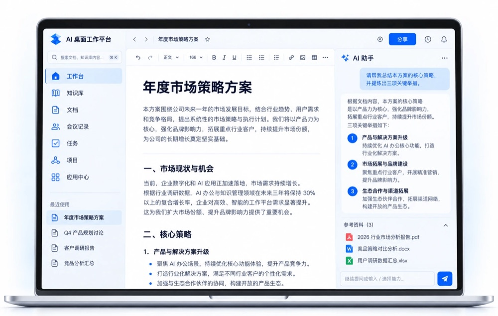
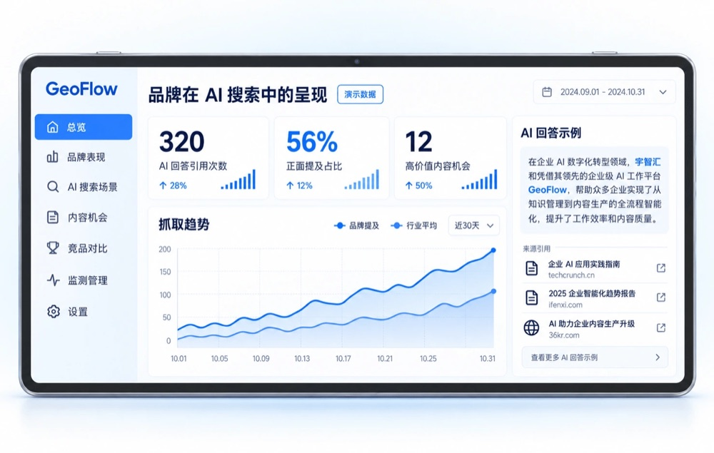

# YUZHH

**Put AI to work.**

[Website](https://yuzhh.com/en) · [Yuz AI](https://yuzhh.com/en/products/yuzai) · [Contact](https://yuzhh.com/en/contact) · [中文](https://github.com/yuzhh-official)

 

<picture>
  <source media="(prefers-color-scheme: dark)" srcset="assets/hero-dark.jpg">
  
</picture>

---

We build industry AI agents that turn large language models into tools for specific jobs.
**Yuz AI** is our product brand, with desktop agents (Windows / macOS / Linux, all in closed beta) for higher education, e-commerce content, and brand visibility in AI search.

## Yuz AI products

<table>
<tr>
<td width="33%" valign="top">

### Yuz EDU
**AI courseware for universities**

Creates lecture videos, courseware and diagrams for abstract concepts, with review and publishing inside the teaching team.

</td>
<td width="33%" valign="top">

### Yuz Etail
**E-commerce content**

Creates product titles and selling points, product images and short videos, and multilingual listings for cross-border sellers. Built for brands and merchants.

</td>
<td width="33%" valign="top">

### Yuz GEO
**Brand visibility in AI search** · `Coming soon`

Generative Engine Optimization: organizes a brand's key facts, tracks how the brand appears in AI search and answers, and improves the content those answers can cite.

</td>
</tr>
</table>

## Product interfaces

<table>
<tr>
<td width="50%" valign="top" align="center">

<picture>
  <source media="(prefers-color-scheme: dark)" srcset="assets/desktop-dark.jpg">
  
</picture>

Yuz AI desktop · Concept interface

</td>
<td width="50%" valign="top" align="center">

<picture>
  <source media="(prefers-color-scheme: dark)" srcset="assets/geo-dark.jpg">
  
</picture>

Yuz GEO · Concept interface · Demo data

</td>
</tr>
</table>

## Learn more

| | |
|---|---|
| Company | [yuzhh.com](https://yuzhh.com/en) · [About](https://yuzhh.com/en/about) · [News](https://yuzhh.com/en/news) |
| Yuz AI | [Product overview](https://yuzhh.com/en/products/yuzai) · [Yuz GEO preview](https://yuzhh.com/en/products/yuzgeo) |
| Business | For deployment, system integration and product demos, reach us through the [contact page](https://yuzhh.com/en/contact) |

<picture>
  <source media="(prefers-color-scheme: dark)" srcset="assets/about-dark.jpg">
  
</picture>

Yuzhihuihe (Dongguan) Technology Co., Ltd.

